# 🖥️ miniVIC Apps

Office applications in 65C02 assembly for the **miniVIC** (and the **BO6502**), in the spirit of the programs of the VIC-20 years (1980-1983): a text editor, a spreadsheet, a card file, a monitor, an assembler and a few utilities.
They are small and essential, but they do real work on a 1 MHz W65C02S with 32 KB of RAM, a TMS9918A in 40-column text mode, a PS/2 keyboard and an SD card.

---

## 📦 Applications

| App | File | Type | What it is |
| :--- | :--- | :---: | :--- |
| ✍️ [**miniVIC WRITE**](#%EF%B8%8F-minivic-write--text-editor) | `bin/write.bin` | APP | Text editor in the WordStar style |
| 📊 [**miniVIC CALC**](#-minivic-calc--spreadsheet) | `bin/calc.bin` | APP | Spreadsheet in the VisiCalc style |
| 🗂️ [**miniVIC FILE**](#%EF%B8%8F-minivic-file--card-file) | `bin/file.bin` | APP | Card file in the PFS:File style |
| 🗓️ [**miniVIC DESK**](#%EF%B8%8F-minivic-desk--calculator-calendar-clock) | `bin/desk.bin` | APP | Adding machine, calendar, clock with alarm |
| 📡 [**miniVIC TERM**](#-minivic-term--serial-terminal) | `bin/term.bin` | APP | Serial terminal in the VicTerm style |
| 🔧 [**miniVIC MON**](#-minivic-mon--machine-language-monitor) | `bin/mon.bin` | TOOL | Machine language monitor in the Supermon style |
| 💾 [**miniVIC DISK**](#-minivic-disk--sd-card-manager) | `bin/disk.bin` | TOOL | SD card manager: programs and documents |
| 🛠️ [**miniVIC ASM**](#%EF%B8%8F-minivic-asm--65c02-assembler) | `bin/asm.bin` | TOOL | Two-pass 65C02 assembler |

Every application is a `.bin` loaded at `$0FD0` and started at `$1000`, like the miniVIC games, and it runs from the SD menu of the BIOS.
When a program starts, the BIOS sends one line on the serial port with its type and name (`[APP] WRITE`, `[TOOL] MON`, `[GAME] ASTEROIDS`); the screen is never mirrored on the serial port.

---

## ⚙️ Requirements

- BIOS **27.10.26 KEYB/SD** (a fork of the miniVIC BIOS 24.10.26), which adds:
  - the extended keyboard: arrows, Home/End, PgUp/PgDn, Ins/Del, F1-F12, Ctrl, Alt, Caps Lock;
  - SD sector read and write for every card type (SDSC v1/v2, SDHC/SDXC);
  - the `[TYPE] Name` serial line.
- A PS/2 keyboard, US layout.
- An SD card made with [bo6502-SDbuilder](https://github.com/Boogs77/bo6502-SDbuilder), which puts the games and these applications in the same menu. **No SD image is published here.**

### 📄 Documents on the SD card

The documents live after the program area, from sector 16384 (byte `$00800000`), so building or updating the SD menu never touches them.
- Sector 16384 is the index: 15 documents, with a name of 12 characters and a type.
- Every document has 40 sectors (20 KB).

| Type | Made by | Opened by |
| :--- | :--- | :--- |
| `TEXT` | WRITE, TERM (capture) | WRITE, ASM (source), TERM (send) |
| `SHEET` | CALC (saved as readable text) | CALC, WRITE |
| `FILE` | FILE | FILE |
| `CODE` | MON, ASM | MON |

DISK views, renames, copies and deletes every type.

### ⌨️ Common keys

All the applications share the same conventions:
- `^` means **Ctrl**. `^KS` is a two-key command: Ctrl+K, then S.
- Every command with an arrow or a function key also has a Ctrl+letter shortcut, for compact keyboards.
- `F1` (or `^J`) shows the help.
- `F10` or `^KQ` / `Q` goes back to the BIOS menu, asking first if something is not saved.

---

## ✍️ miniVIC WRITE – text editor

A word processor in the style of *WordStar* (1978):
- the Ctrl "diamond" moves the cursor, and `^K` / `^Q` start the two-key commands;
- words wrap at 40 columns by themselves;
- blocks show in inverse;
- a document holds up to 20,480 characters (a gap buffer in `$3000-$7FFF`).

<p>
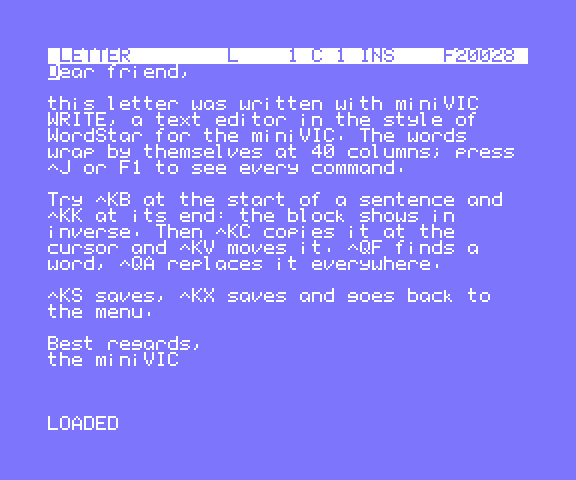
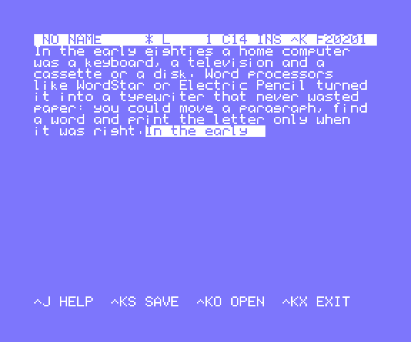
</p>

| Function | WordStar | Keys |
| :--- | :--- | :--- |
| cursor up / down / left / right | `^E ^X ^S ^D` | arrows |
| word left / right | `^A ^F` | |
| start / end of line | `^QS ^QD` | Home End |
| page up / down | `^R ^C` | PgUp PgDn |
| start / end of text | `^QR ^QC` | |
| delete character | `^G` | Del |
| delete left | `^H` | Backspace |
| delete word / line / to end of line | `^T` / `^Y` / `^QY` | |
| split the line | `^N` | |
| insert / overwrite | `^V` | Ins |
| block begin, end, hide | `^KB ^KK ^KH` | F6 F7 |
| block copy, move, delete | `^KC ^KV ^KY` | F8 F9 |
| go to block begin / end | `^QB ^QK` | |
| find, find again | `^QF`, `^L` | F4, F5 |
| replace all | `^QA` | |
| save, save as | `^KS`, `^KA` | F2 |
| open, new | `^KO`, `^KN` | F3 |
| save and exit, quit | `^KX` (`^KD`), `^KQ` | F10 = quit |
| help | `^J` | F1 |

- Row 0 is the status bar: name, `*` if changed, line, column, INS/OVR, the `^K`/`^Q` prefix waiting for its letter, free bytes.
- Row 23 shows messages and questions.

---

## 📊 miniVIC CALC – spreadsheet

A spreadsheet in the style of *VisiCalc* (1979):
- 26 × 99 cells, with 4 columns of 9 characters on the screen, or more with `/W`;
- an entry that starts with a letter or `"` is a label; any other entry is a value or a formula;
- numbers are fixed point with 2 decimals, from -21,474,836.47 to 21,474,836.47. A division by zero or an overflow shows `ERROR`.

<p>
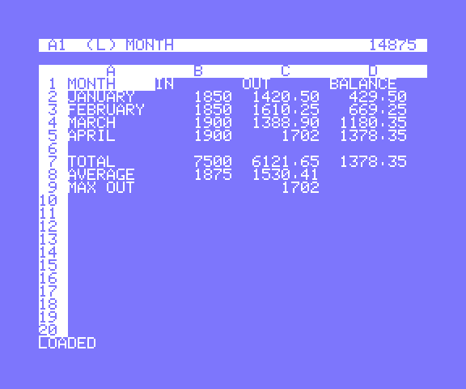
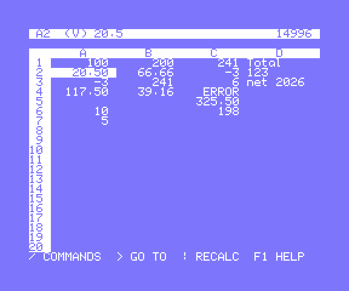
</p>

**Formulas:**
- operators `+ - * /` with precedence, parentheses and unary minus;
- cells `A1`…`Z99`; `$` keeps the column or the row fixed when copying (`$A$1`);
- a formula that starts with a cell is written with `+`, as in VisiCalc: `+A1*2`;
- `@SUM @AVG @MIN @MAX @COUNT` work on ranges (`A1:C3` or `A1...C3`) and on lists (`@SUM(A1,B1,5)`); there are also `@ABS(x)` and `@INT(x)`.
- The sheet is recalculated after every change.

| Key | Function |
| :--- | :--- |
| arrows, `^E ^X ^S ^D` | move between cells |
| `Tab` | cell to the right |
| `Enter` | cell below (while typing: enter the entry and stay) |
| `PgUp PgDn` (`^R ^C`) | 20 rows |
| `Home` | go to A1 |
| any character | start an entry: `Backspace` corrects, `Esc` cancels, `Enter` or an arrow stores it |
| `F2` | edit the cell |
| `Del` | clear the cell |
| `>` | go to a cell |
| `!` | recalculate |
| `F1` | help |
| `/B` | blank the cell |
| `/C` | clear the sheet |
| `/R` | replicate: FROM a cell or a range, TO a range or a top-left cell; references move, except the ones with `$` |
| `/W` | column width, 4 to 18 |
| `/S` `/L` | save, load |
| `/Q` | quit |

A sheet is saved as plain text, one cell per line (`A1 100`, `B1 +A1*2`, `D1 "Total`), so WRITE can open it too.

---

## 🗂️ miniVIC FILE – card file

A card file in the style of *PFS:File* (1980):
- a form has up to 8 fields, each with a name and a width from 1 to 28 characters;
- one card is shown at a time;
- you can find, sort and list the cards.

It starts with an address book form (NAME, ADDRESS, CITY, PHONE, EMAIL, BIRTHDAY, NOTES) that holds 131 cards. With smaller forms it holds up to 250.

<p>
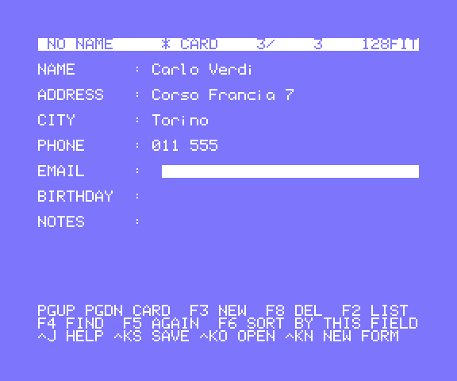
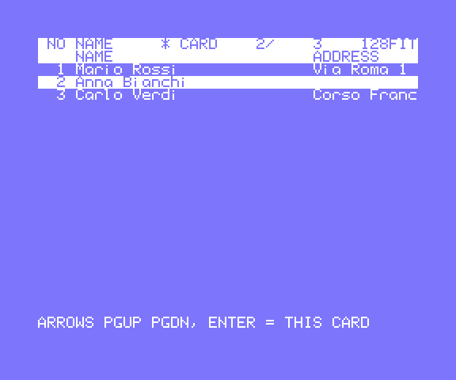
</p>

| Key | Function |
| :--- | :--- |
| `↑ ↓` (`^E ^X`), `Tab`, `Enter` | previous / next field |
| `← →` (`^S ^D`), `Home End` (`^A ^F`) | cursor in the field |
| characters | type over |
| `Backspace`, `Del` (`^G`) | delete, the rest of the field moves |
| `PgUp PgDn` (`^R ^C`) | previous / next card |
| `^T` / `^Z` | first / last card |
| `F3` (`^N`) | new card after the one shown |
| `F8` (`^Y`) | delete the card (asks first) |
| `F2` | list: one card per line; arrows, `PgUp PgDn`, `Enter` opens the card |
| `F4`, `F5` (`^L`) | find a text in every field (case does not matter), find again |
| `F6` | sort by the field of the cursor |
| `^KS ^KA ^KO` | save, save as, open |
| `^KN` | design a new form: name and width of each field, `Enter` on an empty name ends it |
| `^KX`, `^KQ` (`F10`) | save and exit, quit |
| `^J`, `F1` | help |

---

## 🗓️ miniVIC DESK – calculator, calendar, clock

The desk accessories in one program with three pages. The address book is FILE.

<p>
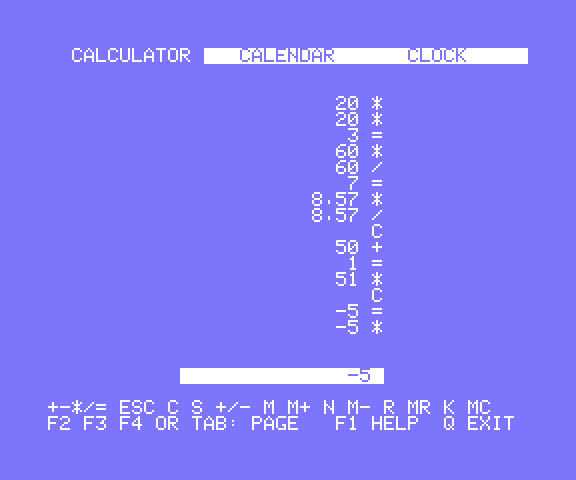
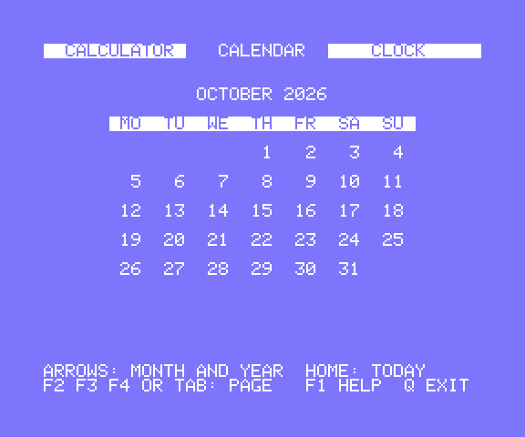
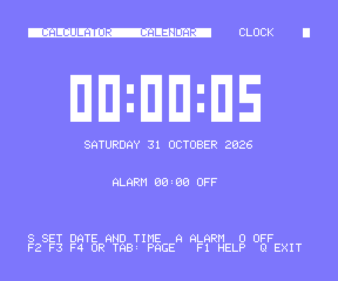
</p>

| Key | Function |
| :--- | :--- |
| `F2` `F3` `F4`, `Tab` | calculator, calendar, clock; next page |
| `F1` | help |
| `Q`, `F10` | back to the BIOS menu |

**Calculator.** It is an adding machine with a paper tape: every number goes on the tape with its operation, and the total is marked with `*`.

| Key | Function |
| :--- | :--- |
| digits, `.` | the number (11 characters) |
| `+ - * /` | operation with the total |
| `=`, `Enter` | result; `=` again repeats the last operation |
| `Esc` | clear all; after an error it is the only key that works |
| `Del`, `Backspace` | clear the number, or its last digit |
| `S` | change sign |
| `M` `N` `R` `K` | `M+` `M-` `MR` `MC` |

**Calendar.**
- A month, with weeks from Monday; today is shown in inverse.
- `← →` change the month and `↑ ↓` the year; `Home` goes back to today.
- Any Gregorian year from 1583 works.

**Clock.**
- Big digits, the date with the day of the week, and the alarm.
- `S` sets the date and the time (`2026 10 30`, `23 59 50`); `A` sets the alarm (`07 30`) and `O` turns it off.
- The alarm flashes `*** ALARM ***` on every page; any key stops it.
- There is no hardware clock: the time is counted with the 60 Hz frame flag of the TMS9918A, and it runs only while DESK is open.

---

## 📡 miniVIC TERM – serial terminal

The miniVIC becomes a terminal on the W65C51 serial port, in the style of *VicTerm*. It is the only program that talks on the serial port.
- **Received text:**
  - control characters CR, LF, BS, TAB and FF;
  - ANSI `ESC[nJ`, `ESC[H`, `ESC[K` and `ESC[nA/B/C/D`; other sequences are ignored;
  - the screen scrolls at the bottom.
- **Reception** works by interrupt, into a 256-byte ring.
- **Capture** holds up to 20 KB and is saved as a text document that WRITE opens.

<p>
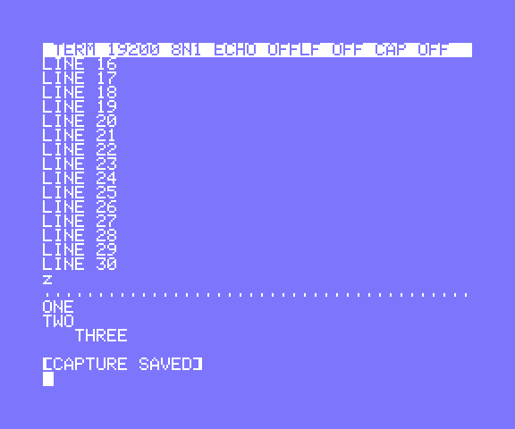
</p>

| Key | Function |
| :--- | :--- |
| characters, `Ctrl`+letter | sent as they are (`^C` = `$03`) |
| `Enter` | `CR`, or `CR LF` (see `F3`) |
| arrows | `ESC[A` `ESC[B` `ESC[C` `ESC[D` |
| `Del` / `Backspace` | `$7F` / `$08` |
| `F1` | help |
| `F2` | local echo on / off |
| `F3` | `Enter` sends `CR LF` / `CR` |
| `F4` | capture on / off |
| `F5` | save the capture as a text document |
| `F6` | send a document of the SD (`Esc` stops) |
| `F7` | speed: 300, 1200, 2400, 4800, 9600, 19200 baud |
| `F10` | back to the BIOS menu, with the serial port set back to 19200 8N1 |

---

## 🔧 miniVIC MON – machine language monitor

A monitor in the style of *Supermon* and *VICMON*. It works in a scrolling console, with one-letter commands and hex numbers.
- It assembles and disassembles the full **W65C02S** set, including `RMB SMB BBR BBS`, `WAI` and `STP`.
- `$3000-$7FFF` is free for your programs.

<p>
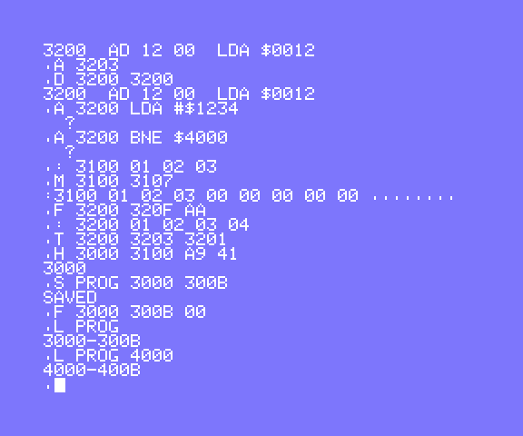
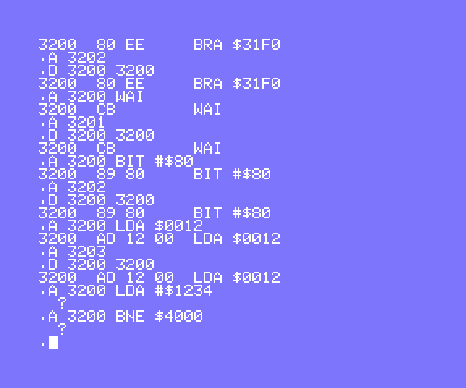
</p>

| Command | Function |
| :--- | :--- |
| `M [a [b]]` | memory dump, 8 bytes per line with the text; without addresses it goes on |
| `: a bb bb …` | write bytes from `a` (a line of `M` can be edited and entered again) |
| `D [a [b]]` | disassemble 20 instructions, or up to `b` |
| `A a instruction` | assemble one line, then it offers the next address; an empty line ends |
| `G a` | call `a` with `JSR`; on `RTS` it shows `A= X= Y= P=` |
| `R` | the registers of the last `G` |
| `F a b v` | fill `a..b` with `v` |
| `T a b c` | copy `a..b` to `c`, overlapping too |
| `H a b bb …` | hunt up to 16 bytes in `a..b` |
| `S name a b` | save `a..b` to the SD card as a CODE document |
| `L name [a]` | load it at its address, or at `a` |
| `X` | back to the BIOS menu |
| `?` | help |

`Esc` stops a long listing.

---

## 💾 miniVIC DISK – SD card manager

A small DOS. It shows the card type (`SDSC V1`, `SDSC V2`, `SDHC`), runs any program of the SD menu, and manages the documents.

<p>
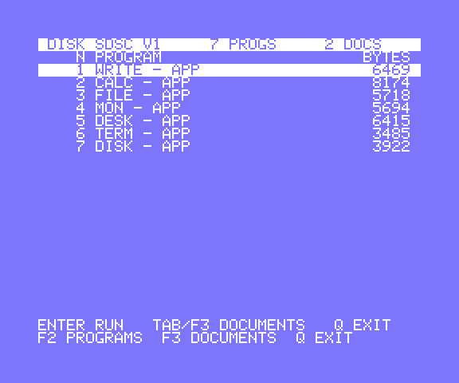
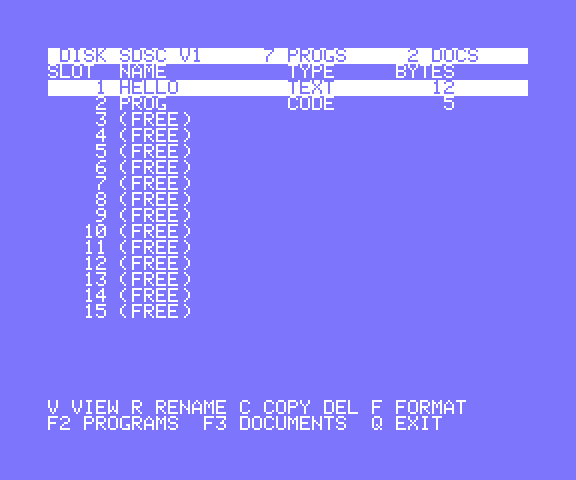
</p>

| Key | Function |
| :--- | :--- |
| `F2` / `F3`, `Tab` | programs / documents |
| arrows (`^E ^X`), `PgUp PgDn` | move in the list |
| `Enter` on a program | run it (asks first), like the BIOS menu |
| `V`, `Enter` on a document | view it, one screen at a time: as text, or in hex for CODE |
| `R` | rename |
| `C` | copy to a free slot with a new name |
| `Del` | delete (asks first) |
| `F` | format: empty the document index (asks first) |
| `Q`, `F10` | back to the BIOS menu |

---

## 🛠️ miniVIC ASM – 65C02 assembler

A two-pass assembler in the style of *Assembler 64*:
- it assembles a source written with WRITE, reading it from the SD card twice without loading it into RAM;
- it saves the code as a CODE document for MON.

In the tests its bytes are the same as the ones of vasm.

<p>
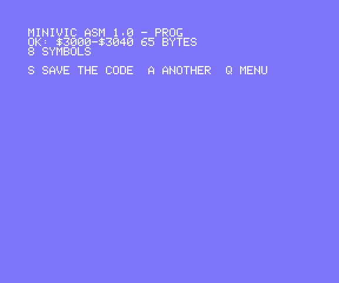
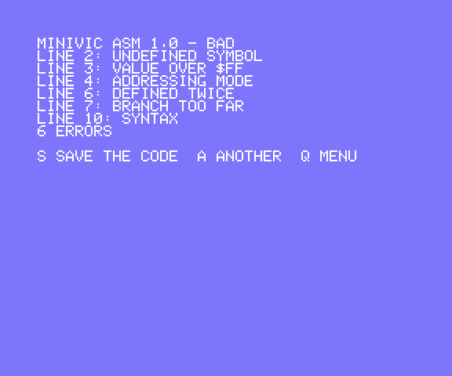
</p>

**How to use it:**
1. Write the source with **WRITE** and save it (`^KS`).
2. Start **ASM** and choose the source with the arrows and `Enter`. ASM shows the errors (`LINE n: message`), or `OK: $start-$end n BYTES`.
3. `S` saves the code, `A` assembles another text, `Q` goes back to the menu.
4. In **MON**: `L name` loads the code, `G address` runs it.

```
; comment
SCREEN = $0800            ; constant
        .ORG $3000
START:  LDX #0            ; label in column 1, the colon is optional
LOOP    LDA MSG,X
        BEQ DONE
        JSR $FD00         ; JT_CHROUT
        INX
        BNE LOOP
DONE    RTS
MSG     .BYTE "HELLO",13,0
```

| Item | Syntax |
| :--- | :--- |
| line | `[LABEL[:]] [INSTRUCTION operand \| .DIRECTIVE] [; comment]`, or `NAME = expression` |
| symbols | letters, digits, `_`; 8 significant characters, up to 340 symbols |
| directives | `.ORG` (default `$3000`), `.BYTE` / `.TEXT` (expressions and `"strings"`), `.WORD`, `.RES n` |
| expressions | `$hex`, `%binary`, decimal, `'c'`, `*`, symbols, `+ -`, unary minus, `<` low byte, `>` high byte |
| instructions | the full W65C02S set: `RMB3 $10`, `BBS7 $10,LABEL`, `(zp)`, `(abs,X)`, `INC A`… |

Errors: `SYNTAX`, `UNDEFINED SYMBOL`, `DEFINED TWICE`, `ADDRESSING MODE`, `BRANCH TOO FAR`, `VALUE OVER $FF`, `OUT OF THE 16 KB AREA`, `TOO MANY SYMBOLS`.

---

## 🔧 Build and test

```powershell
.\build.ps1            # assembles apps\*.asm into bin\ (vasm6502_oldstyle, path in vasm.path)
.\build.ps1 calc mon   # only some applications
.\build.ps1 -Test      # then runs the tests in the emulator core
```

**Tests:**
- They need [BO6502-miniVIC-emulator](https://github.com/Boogs77/BO6502-miniVIC-emulator), cloned in a folder `bo6502-emulator` next to this one, and the BIOS KEYB/SD binary in the `BIOS_ROM` variable.
- Each application is loaded from the SD menu, as on the real machine.
- The tests type on the emulated PS/2 keyboard, check the screen and the SD image, measure the cycles and take the screenshots.

---

## 📂 Layout

```
apps/         one .asm per application
lib/          shared modules: interrupt keyboard queue, 40-column text with inverse font,
              scrolling console, numbers, 32-bit fixed point, SD documents and streams,
              prompts and document list, W65C02S opcode table
bin/          assembled .bin files and listings
screenshots/  taken by the tests
tools/        test runner, tests, opcode table generator, branch fixer
```

---
*Created by Boogs77 - 2026*
